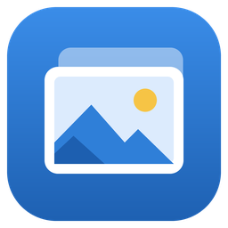
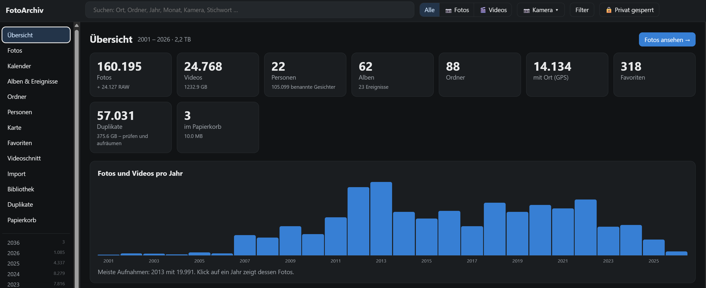
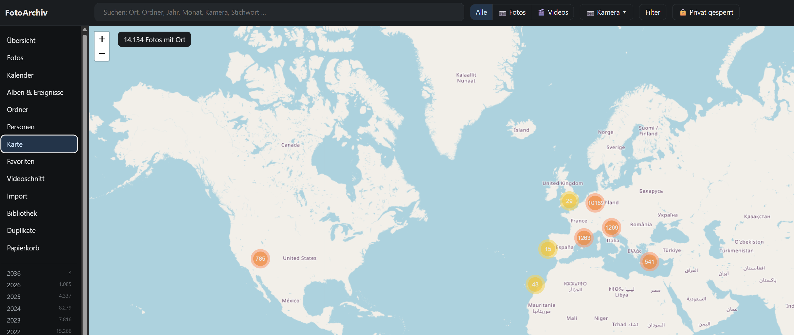
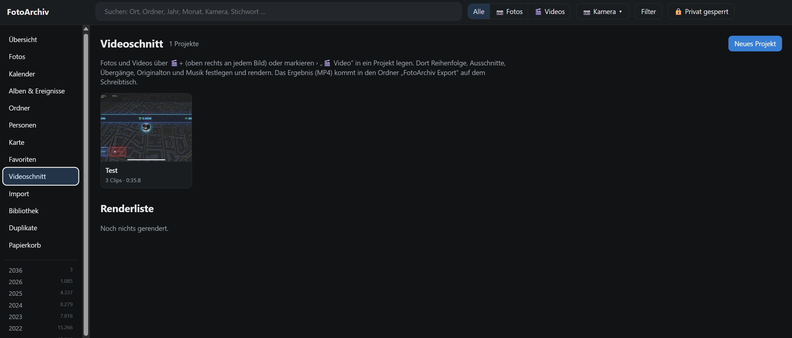
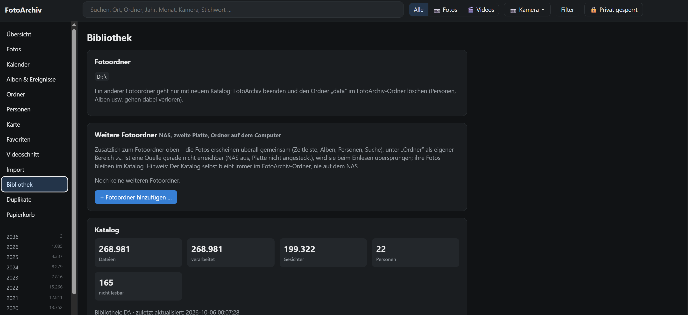

# FotoArchiv

A photo manager that runs in your browser – no cloud, no subscription, no installation. It runs on Windows and
macOS straight from a folder (also from an external drive) and leaves your photos where they are.
Interface in **English and German**. *[Deutsche Beschreibung weiter unten](#deutsch)*

- Timeline, calendar, folders, map, favorites, full-text search (place, month, camera, keyword …)
- Viewer with **full screen** and browsing; **slideshows** old → new, new → old or shuffled
- Filter by photo/video and **camera** (e.g. all GoPro footage), also inside albums, years and folders
- Several photo folders: external drives, **NAS**, local folders – searchable together
- **Photo editing** (crop, straighten, light, color, shadows/highlights – the original stays untouched)
- **Video editor** with timeline, transitions, original audio and music; rendering on all CPU cores
- **Face recognition** on your own computer: faces are grouped, naming once is enough
- Albums, events, private (password-protected) photos; search and filters also within a single album/event
- **Custom cover images** for albums, events, folders, people and calendar months
- Find and clean up **duplicates**, trash with restore (large batches run in the background with progress)
- **360° photos** (GoPro Fusion, Theta, Insta360, Photo Sphere) viewed all around – right in the browser
- **Exposure brackets** detected and shown as stacks – never treated as duplicates
- **Documents**: photos of letters, receipts and screenshots are detected (also after every import) and taken out
  of the timeline; **document albums** kept separate from photo albums; **text recognition** (Windows, offline,
  also rotated photos) makes the text searchable
- **Backup to S3** (Amazon S3 or S3-compatible storage such as MinIO): in the background, only new files, large
  files in parts, resumable, with restore; share albums/events as a **web page** in the bucket
- **Archive view in the bucket** – browse the whole collection without FotoArchiv, laid out like FotoArchiv
  (overview with “On this day”, timeline, calendar, albums & events, folders, people, map, favorites, search,
  videos, 360°); **private photos encrypted** (AES-256, same password as in FotoArchiv); changes are synced
  automatically. The bucket stays private (signed links)
- Capture date of AVCHD camcorders (MTS) read from the video stream
- **Import** from iCloud (several accounts and shared library, fast check for new items), Google Takeout,
  folders, ZIP files – copy or move; photos and videos can go to separate folders
- **Inbox folder**: just drop files into it (also over the network) – FotoArchiv imports them by itself,
  detects duplicates, turns subfolders into albums and keeps Live Photos together
- **Back to iCloud** (Windows, with “iCloud for Windows”): upload single photos or whole albums/events, also
  automatically for new photos; local disk space is freed afterwards. **Shared iCloud albums** are imported as albums
- Slideshow (also as a video), sharing, to your phone via QR code, Samsung TV / The Frame
- Fill a folder for the **Amazon Photos app** (album, favorites)
- Optional import from Mylio
- Settings (library, import, backup) neatly grouped, every section collapsible with a short explanation

## Screenshots

| Overview | Map |
|---|---|
|  |  |
| **Video editor** | **Library with additional photo folders (NAS)** |
|  |  |

*(Screenshots show the German interface; switch to English under Settings › Library › “Sprache · Language”,
or open `http://127.0.0.1:8765/?lang=en`.)*

## Download and start

1. Download `FotoArchiv.zip` from **[Releases](../../releases)** and unzip it.
   Put the `FotoArchiv` folder in a permanent place (e.g. Documents or your photo drive).
2. **Windows:** double-click `Verknüpfung anlegen (Windows).cmd` (creates desktop + start menu shortcuts) or
   start `FotoArchiv starten (Windows).cmd` directly.
   **Mac:** `FotoArchiv.app` – the first time right-click › Open.
3. In the browser, **choose your photo folder** and click “Update library”.

Nothing is installed, no admin rights or internet are needed. On first start the bundled Python runtime is
unpacked once into your user folder (about a minute).

## Updating to a new version

1. Quit FotoArchiv (Settings › Library › “Quit FotoArchiv”, or close the black window).
2. Replace everything in your `FotoArchiv` folder with the contents of the new ZIP – **except the `data`
   folder** (catalog, people, albums, edits, settings, thumbnails) and your own songs in `Musik`.
3. Start FotoArchiv as usual – it updates the catalog by itself.

**Never delete or overwrite `data`** – that would start your catalog from scratch.

## Project layout

| Folder | Contents |
|---|---|
| `app/` | Server (Python, standard library + image processing) and interface (`static/`, vanilla JS) |
| `models/` | Face models (OpenCV YuNet/SFace), text detection (PP-OCR) and place data (GeoNames) |
| `runtime/` | Python + packages per platform – **only in the release ZIP**, rebuild with `tools/build_runtime.py` |
| `tools/` | Build runtime, create icon, build package, Mylio export |
| `data/` | created on first start: catalog, thumbnails, settings (never belongs in the repository) |

## Contributing

FotoArchiv is a private hobby project without commercial intent – contributions are welcome:

- **Bug or idea?** Describe it under [Issues](../../issues) (screenshots and Windows/Mac version help).
- **Questions, experiences, “I’d like to help”:** [Discussions](../../discussions).
- **Improved something yourself?** Pull requests are welcome. The code deliberately avoids frameworks
  (Python standard library + image processing, vanilla JS). UI texts are written in German in the code; the
  English interface comes from `app/static/i18n_en.js` (dictionary) and `i18n.js`. The detailed manual
  (`LIESMICH.txt`) is currently German only.

## License and liability

FotoArchiv is licensed under the **GNU General Public License v3.0** ([LICENSE](LICENSE)): anyone may use,
modify and share it; whoever distributes a modified version must publish its source code under the GPL-3.0 too.

The software is provided free of charge and **without any warranty** (see sections 15 and 16 of the license).
It does not alter photos, but can move or delete them on request (trash) – as with any software, please keep
regular backups.

Bundled third-party components are under their own licenses: overview in [DRITTANBIETER.md](DRITTANBIETER.md),
full texts in the [Lizenzen](Lizenzen) folder. Place data © [GeoNames](https://www.geonames.org) (CC BY 4.0),
map tiles © OpenStreetMap contributors. Apple, iCloud, Google, Samsung, The Frame, Amazon, Amazon S3,
NetApp StorageGRID and Mylio are trademarks of their respective owners; FotoArchiv is not affiliated with any
of these companies.

---

## Deutsch

Fotoverwaltung im Browser – ohne Cloud, ohne Abo, ohne Installation. Läuft unter Windows und macOS
direkt aus einem Ordner (auch von einer externen Festplatte) und lässt die Fotos, wo sie sind.
Oberfläche auf **Deutsch und Englisch**.

- Zeitleiste, Kalender, Ordner, Karte, Favoriten, Volltextsuche (Ort, Monat, Kamera, Stichwort …)
- Betrachter mit **Vollbild** und Blättern; **Diashow** in Reihenfolge alt → neu, neu → alt oder zufällig
- Filter nach Fotos/Videos und **Kamera** (z. B. alle GoPro-Aufnahmen), auch innerhalb von Alben, Jahren, Ordnern
- Mehrere Fotoordner: externe Platten, **NAS**, lokale Ordner – gemeinsam durchsuchbar
- **Fotobearbeitung** (zuschneiden, begradigen, Licht, Farbe, Tiefen/Lichter – Original bleibt unverändert)
- **Videoschnitt** mit Zeitleiste, Übergängen, Originalton und Musik; Rendern auf allen Prozessorkernen
- **Gesichtserkennung** auf dem eigenen Computer: Gesichter werden gruppiert, einmal benennen genügt
- Alben, Ereignisse, private (passwortgeschützte) Fotos; Suche und Filter auch nur innerhalb eines Albums/Ereignisses
- **Titelbild selbst wählen** für Alben, Ereignisse, Ordner, Personen und Kalender-Monate
- **Duplikate** finden und aufräumen, Papierkorb zum Wiederherstellen (große Mengen mit Fortschritt im Hintergrund)
- **360°-Fotos** (GoPro Fusion, Theta, Insta360, Photo Sphere) rundum ansehen – direkt im Browser
- **Belichtungsreihen** (Bracketing) erkennen und als Stapel zeigen – nie als Duplikat behandelt
- **Dokumente**: Fotos von Briefen, Rechnungen, Bildschirmfotos werden erkannt (auch nach jedem Import) und aus
  der Zeitleiste genommen; **Dokumentenalben** getrennt von den Fotoalben; **Texterkennung** (Windows, offline,
  auch gedrehte Fotos) macht den Text durchsuchbar
- **Sicherung auf S3** (Amazon S3 oder eigener S3-Speicher wie StorageGRID/MinIO): im Hintergrund, nur Neues,
  große Dateien in Teilen, fortsetzbar, mit Wiederherstellen; Alben/Ereignisse als **Webseite** im Bucket teilen
- **Archiv-Ansicht im Bucket** – die ganze Sammlung ohne FotoArchiv im Browser ansehen, aufgebaut wie FotoArchiv;
  **private Fotos verschlüsselt** (AES-256, gleiches Passwort wie in FotoArchiv); Änderungen werden automatisch
  nachgezogen. Der Bucket bleibt privat (signierte Links)
- Datum aus AVCHD-Camcordern (MTS) wird aus dem Videostrom gelesen
- **Import** aus iCloud (mehrere Konten und geteilte Bibliothek, schneller Abruf nur des Neuen), Google Takeout,
  Ordnern, ZIP-Dateien – wahlweise kopieren oder verschieben; Fotos und Videos können in getrennte Ordner
- **Eingangsordner**: Dateien einfach hineinkopieren (auch übers Netz) – FotoArchiv übernimmt sie von selbst,
  erkennt Doppelte, macht aus Unterordnern Alben und hält Live Photos zusammen
- **Zurück nach iCloud** (Windows, mit „iCloud für Windows“): einzelne Fotos oder ganze Alben/Ereignisse hochladen,
  auch automatisch für neue Fotos; danach wird am PC der Speicher wieder freigegeben. **Geteilte iCloud-Alben**
  werden als Alben importiert
- Diashow (auch als Video), Teilen, aufs Handy per QR-Code, Samsung-Fernseher / The Frame
- Ordner für die **Amazon-Photos-App** füllen (Album, Favoriten); Übernahme aus Mylio (optional)
- Einstellungen (Bibliothek, Import, Sicherung) übersichtlich gruppiert, jeder Punkt aufklappbar mit kurzer Erklärung

### Herunterladen und starten

1. Unter **[Releases](../../releases)** die Datei `FotoArchiv.zip` herunterladen und entpacken.
   Den Ordner `FotoArchiv` an einen festen Platz legen (z. B. Dokumente oder die Foto-Festplatte).
2. **Windows:** `Verknüpfung anlegen (Windows).cmd` doppelklicken (Desktop + Startmenü) oder direkt
   `FotoArchiv starten (Windows).cmd`.
   **Mac:** `FotoArchiv.app` – beim ersten Mal Rechtsklick › Öffnen.
3. Im Browser den **Fotoordner wählen** und „Bibliothek aktualisieren“.

### Auf eine neue Version aktualisieren

1. FotoArchiv beenden (Einstellungen › Bibliothek › „FotoArchiv beenden“ oder das schwarze Fenster schließen).
2. Alles im Ordner `FotoArchiv` durch den Inhalt der neuen ZIP ersetzen – **außer dem Ordner `data`** (Katalog,
   Personen, Alben, Bearbeitungen, Einstellungen, Vorschaubilder) und eigenen Liedern in `Musik`.
3. FotoArchiv wie gewohnt starten – der Katalog wird von selbst ergänzt.

**`data` nie löschen oder überschreiben** – sonst beginnt der Katalog von vorn.

Alles Weitere steht in [LIESMICH.txt](LIESMICH.txt).

### Mitmachen

FotoArchiv ist ein privates Freizeitprojekt ohne kommerzielle Absichten – Mitarbeit ist willkommen:
Fehler und Ideen unter [Issues](../../issues), Fragen und Erfahrungen unter [Discussions](../../discussions),
Verbesserungen gern als Pull Request. Die Texte stehen deutsch im Code; die englische Oberfläche kommt aus
`app/static/i18n_en.js` (Wörterbuch) und `i18n.js`.

### Lizenz und Haftung

FotoArchiv steht unter der **GNU General Public License v3.0** ([LICENSE](LICENSE)): Jeder darf es nutzen,
verändern und weitergeben; wer eine veränderte Fassung weitergibt, muss deren Quelltext ebenfalls unter der
GPL-3.0 offenlegen. Die Software wird unentgeltlich und **ohne jede Gewährleistung** bereitgestellt (siehe
Abschnitte 15 und 16 der Lizenz). Sie verändert Fotos nicht, kann sie aber auf Wunsch verschieben oder löschen
(Papierkorb) – bitte wie bei jeder Software regelmäßig Sicherungen anlegen.

Mitgelieferte fremde Bestandteile stehen unter ihren eigenen Lizenzen: Übersicht in
[DRITTANBIETER.md](DRITTANBIETER.md), vollständige Texte im Ordner [Lizenzen](Lizenzen).
Ortsdaten © [GeoNames](https://www.geonames.org) (CC BY 4.0), Kartenbilder © OpenStreetMap-Mitwirkende.
Apple, iCloud, Google, Samsung, The Frame, Amazon, Amazon S3, NetApp StorageGRID und Mylio sind Marken ihrer
Inhaber; FotoArchiv ist mit keinem dieser Unternehmen verbunden.
